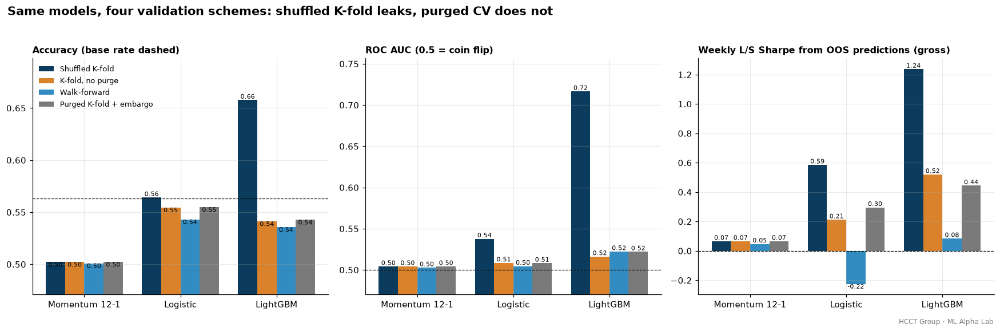
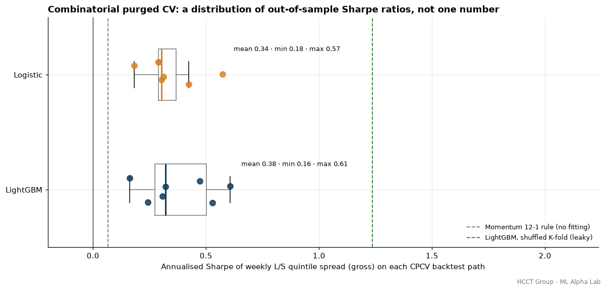
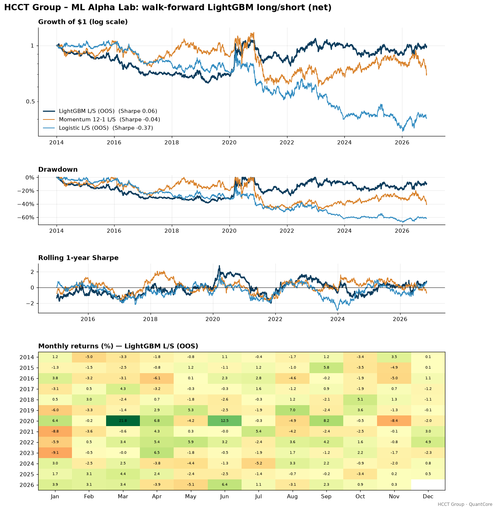
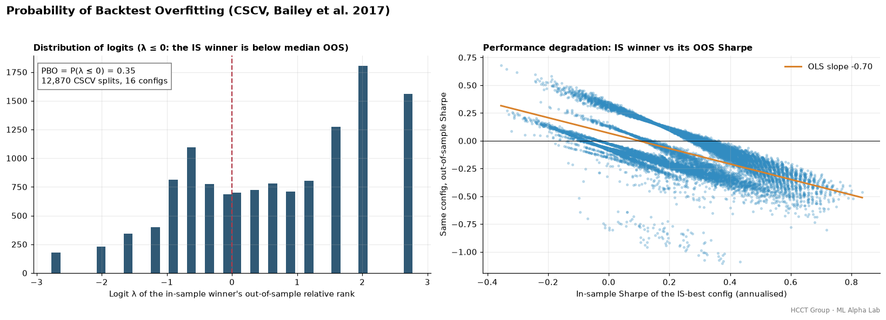
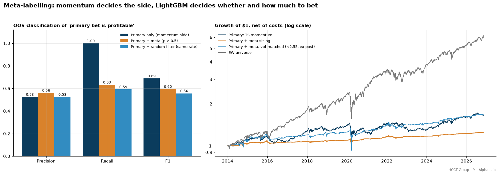
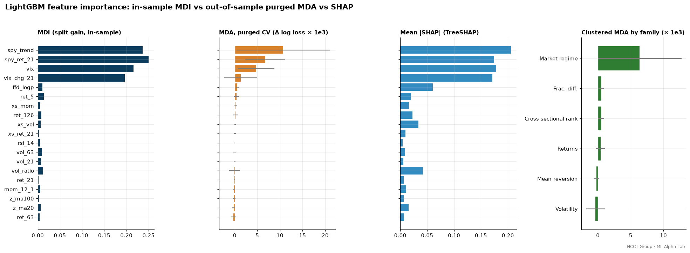
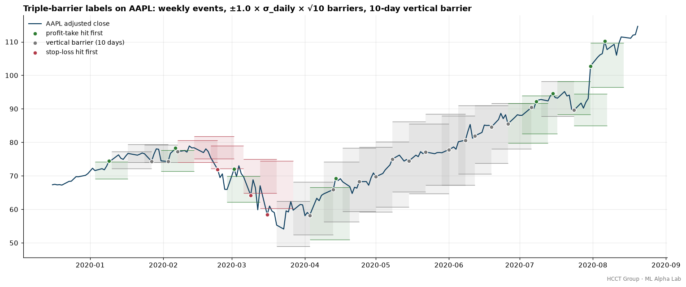
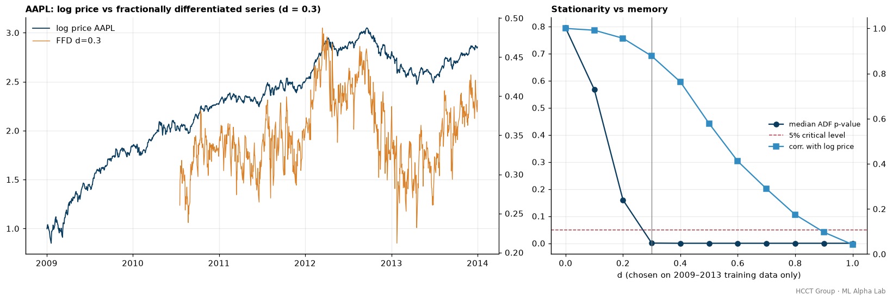

# HCCT Group – ML Alpha Lab

**Financial machine learning done right: triple-barrier labels, purged and embargoed CV, CPCV, meta-labelling, LightGBM and overfitting diagnostics on 100 US large caps.**
Created by **Harry CHU** · HCCT Group

[](https://github.com/hcctbusiness/ML-Alpha-Lab/actions/workflows/ci.yml)


This repository applies the methodology of Marcos López de Prado's *Advances in Financial Machine Learning* (AFML) to a stock-selection problem, and asks one question: **how much of a machine-learning "edge" survives proper validation?** It labels 84,870 weekly stock events (100 US large caps, 2010–2026) with the triple-barrier method and weights them by label uniqueness. It then fits a LightGBM classifier on 19 causal, price-only features, including a fractionally differentiated price. The same model is scored four ways: shuffled K-fold, contiguous K-fold without purging, walk-forward, and purged K-fold with an embargo. Combinatorial purged CV (CPCV) gives a distribution of out-of-sample Sharpe ratios. A walk-forward backtest, net of costs, is compared against logistic regression, a 12-1 momentum rule and the equal-weight universe. Meta-labelling puts a LightGBM filter on top of a momentum primary model. Every configuration that was evaluated is logged, and that count feeds the **Deflated Sharpe Ratio**, the **Probability of Backtest Overfitting** and the **minimum backtest length**. All hyper-parameters, the 16-config grid, the barriers and the embargo were fixed before the first run. Backtesting runs on [QuantCore](https://github.com/hcctbusiness/QuantCore), the shared HCCT Group engine. Every number below comes from `python run_ml_alpha_lab.py` (about 3 minutes on 4 CPU cores).

**The headline:** shuffled K-fold reports 66% accuracy, 0.72 AUC and a 1.24 Sharpe for LightGBM. Under purged CV the AUC falls to 0.52, and accuracy (54%) is below the 56% you get by always predicting "up". The real walk-forward long/short book earned a **0.34 Sharpe before costs and 0.06 after**. Its Deflated Sharpe Ratio is 0.17, so the result is not significant.



## Methodology

| Step | Implementation |
|---|---|
| Data | Yahoo Finance adjusted closes via `quantcore.data`, 2009-01 → 2026-11, on SPY's trading calendar (gaps forward-filled ≤ 5 bars). 2009 to mid-2010 is warm-up only. SPY and ^VIX supply the market features. |
| Universe | 100 liquid S&P 500 large caps, all listed before 2010 (`universe.py`, reused from [Equity-Factor-Model](https://github.com/hcctbusiness/Equity-Factor-Model)). These are today's survivors (see Limitations). |
| Events | One event per stock per week (last trading day of the week): 84,870 events from 2010-07-23 with complete features and labels. |
| Triple-barrier labels | Profit-take and stop-loss at ±1.0 × σ<sub>daily</sub> × √10, where σ<sub>daily</sub> is the 63-day std of log returns known at t₀, plus a **10-day vertical barrier**. Label = 1 if the return at the first touch is positive. Hits: profit-take 23.5%, stop-loss 19.4%, vertical 57.1%. Base rate of label 1: **56.3%**. |
| Sample weights | Average uniqueness per label: the mean over the label's life of 1 / (number of the same stock's labels alive on that bar) (AFML 4.2). Mean 0.52, because weekly events with 10-day horizons overlap about twice. Used as `sample_weight` in every fit. |
| Features (19, causal) | **Returns:** 5/21/63/126-day log returns and 12-1 momentum. **Volatility:** 21- and 63-day realised vol and their ratio. **Mean reversion:** z-score vs 20- and 100-day moving averages, RSI(14). **Fractional differentiation:** FFD log price. **Cross-sectional ranks:** of 21-day return, 12-1 momentum and 63-day vol. **Market regime:** SPY 21-day return, SPY vs its 200-day average, VIX level and 21-day VIX log change. |
| Fractional differentiation | Fixed-width-window FFD (weights w<sub>k</sub> = −w<sub>k−1</sub>(d−k+1)/k, truncated at \|w\| < 1e-4). **d = 0.3** is the smallest d on a 0.1 grid where the median ADF p-value across stocks is below 0.05, using **2009–2013 data only**. The window is 388 bars, and the FFD series keeps a 0.88 correlation with the log price. |
| Models | **LightGBM** (main, fixed upfront): 15 leaves, 300 trees, learning rate 0.03, min 200 samples per leaf, 70% row and column subsampling. **Logistic regression** (C = 1, standardised). **Momentum 12-1 rule**: score = cross-sectional rank of 12-1 momentum, with no fitting. |
| CV schemes | 5 folds of contiguous event **dates**, so all stocks on a date land in the same fold. **Shuffled K-fold** (event level, naive). **K-fold, no purge.** **Walk-forward** (expanding window, test folds 2–5). **Purged K-fold + embargo**: training labels whose [t₀, t₁] overlaps the test span are dropped, and so are labels starting within **21 bars** after it. All implemented in `cv.py`. |
| CPCV | N = 8 date groups, k = 2 test groups: C(8,2) = 28 purged and embargoed splits, recombined into 28·2/8 = **7 full backtest paths**. |
| Scoring inside CV | Accuracy, AUC and log loss on OOS predictions. Also the annualised Sharpe of a weekly top-minus-bottom-quintile spread of next-week returns (t+1 → t+6), gross. |
| Feature importance | **MDI**: LightGBM split gain, in-sample. **MDA**: increase in OOS log loss when a feature is permuted, inside purged K-fold. **Clustered MDA**: the same, permuting a whole feature family at once, which handles substitution effects. **SHAP**: mean \|TreeSHAP\| from LightGBM's `pred_contrib`, on 5,000 rows. |
| Walk-forward backtest | The model is refit every January from 2014 on all labels that **ended before** that January (purged expanding window). It predicts every weekly date of the year, including the most recent weeks, which have no label yet. **L/S**: +100% equally in the top quintile of P(up), −100% in the bottom quintile. **Long-only**: top quintile. Rebalanced weekly; weights drift between rebalances. |
| Meta-labelling | **Primary**: time-series momentum, long if a stock's 12-1 return is ≥ 0, else short. **Meta-label** = 1 if that side made money by the first barrier touch. **Secondary**: LightGBM (main config, features + side), walk-forward like above. A trade is acted on if p > 0.5. Size = 2Φ(z) − 1 with z = (p − ½)/√(p(1−p)), floored at 0. Book weight = side × size / N. |
| Execution & costs | Signals at the close of t; QuantCore's `lag=1` trades them at t+1. `qc.CostModel`: **1 bp commission + 2 bp slippage** per unit traded, plus **50 bp/yr borrow** on gross shorts. |
| Overfitting diagnostics | **DSR** (Bailey & López de Prado 2014): PSR against the expected maximum Sharpe of N skill-less trials, with N = **21 logged trials** and the cross-trial Sharpe variance taken from the 16 L/S grid configs. **PBO** via CSCV (Bailey, Borwein, López de Prado & Zhu 2017): 16 grid configs × 16 time blocks = 12,870 splits. **MinBTL** (Bailey et al. 2014). |
| Model grid (the trials) | LightGBM leaves {7, 15, 31} × trees {100, 300} × min leaf {200, 1000}, logistic C {0.01, 1, 100}, and the momentum rule: **16 configurations**, each run as a walk-forward L/S backtest. The grid measures overfitting; it was **not** used to pick the main model, which was fixed in advance. |

Unit tests check that purged CV never puts a training label inside the test span plus the embargo, for PurgedKFold and for every CPCV block. They check that triple barriers hit the right barrier on hand-built paths, and that the vectorised labeller matches a scalar reference. They also check that FFD weights equal (−1)<sup>k</sup>·C(d, k), and that FFD of a random walk passes ADF. Further tests cover uniqueness on known overlaps, the CPCV path count C(N,k)·k/N, a DSR that falls as trials increase, a PBO of about 0.5 on pure noise, and bet sizes in [0, 1]. Finally, changing future prices must leave every past feature and label unchanged.

## Results on real data

Full output, including the FFD selection grid, the feature stationarity table, every grid configuration and the complete trial log, is in [`docs/results.md`](docs/results.md) and [`docs/trials.csv`](docs/trials.csv).

**1. Validation scheme vs measured skill (same events, same models)**

| Model — scheme | Accuracy | AUC | Log loss | Weekly L/S Sharpe (gross) |
|---|---:|---:|---:|---:|
| LightGBM — Shuffled K-fold | **0.658** | **0.717** | 0.626 | **1.24** |
| LightGBM — K-fold, no purge | 0.541 | 0.516 | 0.698 | 0.52 |
| LightGBM — Walk-forward | 0.536 | 0.522 | 0.711 | 0.08 |
| LightGBM — Purged K-fold + embargo | 0.543 | 0.522 | 0.696 | 0.44 |
| Logistic — Shuffled K-fold | 0.564 | 0.538 | 0.682 | 0.59 |
| Logistic — K-fold, no purge | 0.554 | 0.508 | 0.688 | 0.21 |
| Logistic — Walk-forward | 0.543 | 0.505 | 0.697 | −0.22 |
| Logistic — Purged K-fold + embargo | 0.555 | 0.508 | 0.688 | 0.30 |
| Momentum 12-1 rule (no fitting) | 0.502 | 0.504 | — | 0.07 |
| *Always predict "up" (base rate)* | *0.563* | *0.500* | | |

| Gap: shuffled − purged | AUC | Accuracy | L/S Sharpe |
|---|---:|---:|---:|
| LightGBM | **+0.195** | **+0.115** | **+0.79** |
| Logistic | +0.030 | +0.009 | +0.29 |
| Momentum rule | 0.000 | 0.000 | 0.00 |

Dropping the uniqueness weights (LightGBM, purged K-fold) lowers the AUC from 0.522 to 0.519 and the L/S Sharpe from 0.44 to 0.32.

**2. Combinatorial purged CV: 7 backtest paths (gross weekly L/S Sharpe)**

| Model | Mean | Std | Min | Max | Paths > 0 |
|---|---:|---:|---:|---:|---:|
| LightGBM | 0.38 | 0.16 | 0.16 | 0.61 | 7 / 7 |
| Logistic | 0.34 | 0.12 | 0.18 | 0.57 | 7 / 7 |
| Momentum 12-1 rule (single path) | 0.07 | | | | |



**3. Walk-forward backtest, 2014-01-02 → 2026-11-06, net of costs**

| Metric | LightGBM L/S | Logistic L/S | Momentum 12-1 L/S | LightGBM long-only Q5 | Momentum long-only Q5 | EW universe | SPY |
|---|---:|---:|---:|---:|---:|---:|---:|
| CAGR | -0.07% | -6.80% | -2.68% | 15.87% | 16.19% | 14.96% | 13.32% |
| Ann. Vol | 14.03% | 15.68% | 19.67% | 15.45% | 19.22% | 16.27% | 17.12% |
| **Sharpe (net)** | **0.06** | -0.37 | -0.04 | 1.03 | 0.88 | 0.94 | 0.82 |
| Sharpe (gross) | 0.34 | -0.23 | 0.03 | 1.14 | 0.90 | 0.94 | 0.82 |
| Max Drawdown | -38.47% | -67.62% | -48.79% | -26.01% | -33.10% | -35.52% | -33.72% |
| Turnover (× capital / yr) | 112.7 | 58.2 | 28.3 | 55.7 | 13.5 | 1.2 | 0.1 |
| Annual cost drag | 3.88% | 2.25% | 1.35% | 1.67% | 0.40% | 0.04% | 0.00% |
| Beta vs SPY | -0.29 | -0.44 | 0.03 | 0.76 | 0.99 | 0.89 | 1.00 |



**4. Overfitting diagnostics (shown prominently because they decide the conclusion)**

| | LightGBM L/S (pre-specified) | Best L/S grid config (31 leaves, 300 trees) | LightGBM long-only minus EW (active) | Momentum 12-1 L/S (N = 1) |
|---|---:|---:|---:|---:|
| Annualised Sharpe | 0.06 | 0.15 | 0.10 | -0.04 |
| Trials N | 21 | 21 | 21 | 1 |
| E[max SR] of N skill-less trials (ann.) | 0.33 | 0.33 | 0.33 | 0 |
| PSR vs 0 | 0.59 | 0.71 | 0.63 | 0.45 |
| **Deflated Sharpe Ratio** | **0.17** | **0.27** | **0.20** | 0.45 |

| Diagnostic | Value |
|---|---|
| Trials logged ([`trials.csv`](docs/trials.csv)) | 21: 16 grid configs, 2 long-only variants, 2 meta-labelling books, 1 pre-run development check (the EW benchmark is logged but not counted) |
| **PBO** (CSCV, 16 configs, 12,870 splits) | **0.35** |
| Median Sharpe of the in-sample winner: IS → OOS | 0.23 → **−0.11**; the winner's OOS Sharpe is negative in 68% of splits |
| IS-vs-OOS Sharpe slope across splits | −0.70 |
| **MinBTL** for the best L/S Sharpe (0.15) with 21 trials | **156 years** (we have 12.8) |
| MinBTL for a target Sharpe of 0.5 / 1.0 with 21 trials | 14.8 / 3.7 years |



**5. Meta-labelling (OOS events and backtest from 2014)**

| Book | Precision | Recall | F1 | Trades taken |
|---|---:|---:|---:|---:|
| Primary only (momentum side) | 0.525 | 1.000 | 0.689 | 100% |
| **Primary + meta (p > 0.5)** | **0.561** | 0.634 | 0.595 | 59.3% |
| Primary + random filter (same trade rate) | 0.525 | 0.592 | 0.556 | 59.2% |

| Metric (net) | Primary: TS momentum | Primary + meta sizing | EW universe |
|---|---:|---:|---:|
| CAGR | 3.96% | 1.73% | 14.96% |
| Ann. Vol | 10.21% | 4.00% | 16.27% |
| Sharpe | 0.43 | 0.45 | 0.94 |
| Max Drawdown | -23.64% | -12.58% | -35.52% |
| Beta vs SPY | 0.35 | 0.15 | 0.89 |

The meta-model's OOS AUC for "the primary bet is profitable" is 0.550.



**6. Feature importance (LightGBM)**

| Feature family | Purged MDA, clustered (Δ log loss × 1e3) | Top feature by MDA / SHAP |
|---|---:|---|
| Market regime | **6.36 ± 6.39** | spy_trend (MDA 10.7, SHAP share 21%) |
| Fractional differentiation | 0.53 ± 0.36 | ffd_logp (best single stock-level feature) |
| Cross-sectional ranks | 0.50 ± 0.46 | xs_mom |
| Returns | 0.40 ± 0.69 | ret_5 |
| Mean reversion | −0.23 ± 0.40 | — |
| Volatility | −0.37 ± 1.41 | — |






## Reading the results honestly

- **Naive cross-validation invents an edge.** With shuffled K-fold, LightGBM appears to predict the 10-day direction of large-cap stocks with 66% accuracy and 0.72 AUC, and a weekly long/short book built on it shows a 1.24 Sharpe. None of this is real. Under purged K-fold the AUC is 0.522 and accuracy is 54.3%, which is below the 56.3% from always predicting "up". The shuffled split leaks in two ways. Labels of the same stock in adjacent weeks overlap in time (average uniqueness 0.52). More importantly, the four market-regime features are identical for all 100 stocks on a date, so a shuffled model sees most of a test week's market move in training and simply memorises "date → market direction". The more flexible the model, the more it exploits the leak: the AUC gap is +0.195 for LightGBM, +0.030 for logistic regression and zero for the momentum rule, which has nothing to fit.
- **Contiguous folds remove most of the leak, and purging plus the embargo remove the rest.** Contiguous K-fold without purging is already close to the purged result (AUC 0.516 vs 0.522). With only 5 folds, the overlapping labels at fold boundaries are a small share of the data. Purging matters most where the boundary-to-sample ratio is high (many folds, CPCV, long horizons), which is why it is built into every split here anyway.
- **Even purged K-fold flatters the strategy relative to a real walk-forward.** Purged K-fold and CPCV both give a gross L/S Sharpe of about 0.4 (CPCV paths 0.16–0.61, all positive). The walk-forward version of the same model earned 0.08 inside the CV comparison and 0.34 gross in the full backtest. K-fold lets the model train on *later* market regimes (e.g. learn 2020 from 2022) and test on earlier ones, which no live investor can do. CPCV gives a useful distribution, but it is not a substitute for a walk-forward that respects time.
- **After costs, the ML long/short book has no edge.** The pre-specified LightGBM L/S earned −0.07% a year (Sharpe 0.06 net, 0.34 gross). It turns over 113× capital a year because weekly probability ranks are noisy, and costs take 3.9% a year. Logistic regression lost 6.8% a year. The 12-1 momentum L/S lost 2.7% a year in this 2014–2026 large-cap sample, so "the ML model beat momentum" is technically true and means little. The LightGBM book carried a −0.29 beta. Its best months (March 2020 +21.8%, June 2020 +12.5%) came from being net short in the COVID crash, not from stock selection.
- **The Deflated Sharpe Ratio says this is not a discovery.** With 21 honestly counted trials, the expected best Sharpe of skill-less strategies is 0.33. The main model's 0.06 gives DSR 0.17, and the best grid config (0.15) gives DSR 0.27, far below the 0.95 needed for significance. Telling an annualised Sharpe of 0.15 apart from luck across 21 trials would need about 156 years of data. Even a Sharpe of 0.5 would need 14.8 years, more than this 12.8-year out-of-sample window.
- **A PBO of 0.35 looks moderate, but the grid has nothing to overfit to.** The in-sample winner ranks above the OOS median in 65% of the CSCV splits, because the configs are highly correlated (they share features and labels). Its OOS Sharpe is still negative in 68% of splits (median −0.11), and the IS-vs-OOS slope is −0.70, which is the classic sign of backtest overfitting: the better a config looks in-sample, the worse it does afterwards. A low PBO means "selection did not hurt much", not "the strategy works".
- **Meta-labelling did what the theory promises, on a small scale.** The meta-model raised the precision of the momentum primary from 52.5% to 56.1% while taking 59% of the trades. A random filter with the same trade rate stays at 52.5%, so the gain is real information (OOS AUC 0.55). In the backtest, sizing by the meta-probability cut volatility from 10.2% to 4.0%, drawdown from −24% to −13% and beta from 0.35 to 0.15. Sharpe barely moved (0.43 → 0.45). Meta-labelling is a risk filter here, not a return engine.
- **The long-only results are mostly market beta.** The LightGBM long-only top quintile earned a 1.03 Sharpe, but the equal-weight universe earned 0.94 with the same stocks. The active return over EW has a Sharpe of 0.10 and a DSR of 0.20, so it is not significant.
- **What the model actually learns is the market regime, not stock selection.** All four importance methods agree that SPY trend, SPY 21-day return, VIX and the VIX change dominate. In-sample MDI gives them 90% of the gain. Purged MDA shows SPY trend has the largest *and* most unstable OOS contribution (10.7 ± 10.3 × 1e-3 log loss across folds). Volatility and mean-reversion features have zero or negative MDA, meaning they add noise. MDI ranks `vol_ratio` above `ffd_logp`, while MDA and clustered MDA say the opposite, a reminder that in-sample importance is not predictive importance. The FFD price was the most useful stock-level feature, consistent with AFML's argument for keeping memory while making the series stationary. Its absolute contribution is still small.

**Conclusion:** the AFML toolkit turned an apparently excellent model (AUC 0.72, Sharpe 1.24 under shuffled CV) into an honest null result: purged AUC 0.52, a walk-forward net Sharpe of 0.06, DSR 0.17 and a minimum backtest length of more than a century. Price-only features on liquid US large caps do not predict 10-day direction well enough to pay for weekly trading. What the framework does deliver is a reliable way to say *no*, plus a meta-labelling filter that improves the precision and risk profile of a simple momentum rule. The code is the asset here, not the backtest.

## Limitations

- **Survivorship bias.** The universe is 100 of today's large caps that already existed in 2010, chosen with hindsight. Delisted and acquired names are missing, which flatters the long-only and equal-weight books and changes what the cross-section looks like.
- **Price-only features.** There are no fundamentals, earnings, analyst, options or alternative data. Free sources do not offer point-in-time history for these, so they are left out rather than faked. The market-regime features are shared by every stock, which is why the classifier mostly learns market timing.
- **yfinance data quality.** Adjusted closes can contain bad ticks and dividend-adjustment errors, and Yahoo revises history, so numbers will move slightly between runs. VIX is an index level, not a tradable instrument.
- **Compute limits.** To keep the run under ~10 minutes: weekly event sampling (no CUSUM filter), annual refits, a 16-config grid, CPCV with N = 8 / k = 2 (7 paths), SHAP on a 5,000-row sample and MDA with one permutation per fold. A larger grid would raise N and lower the DSR further.
- **Label and CV design choices.** The barrier width (1.0σ√h), horizon (10 days), embargo (21 bars) and fold counts were fixed upfront, not optimised, but they are judgement calls. Uniqueness is computed within each stock. Labels of *different* stocks on the same dates are also correlated, which purging by date handles but the weights do not.
- **Costs and execution.** Costs are linear (3 bp per trade plus 50 bp/yr borrow), with no market impact, hard-to-borrow fees or short-squeeze risk. Trades fill at the next close. The weekly L/S book's 113× turnover would be expensive to run in practice.
- **Trial counting is only as honest as the log.** The trial log covers every configuration whose out-of-sample performance was computed, including one pre-run check of the main model's CV accuracy, and no setting was changed after seeing results. One reporting choice was revised after the first full run: the DSR's cross-trial Sharpe variance is now taken from the homogeneous 16-config L/S grid rather than a mix of L/S and long-only books. This changes the diagnostic, not any strategy. Design choices that were never coded, such as the feature set, are not counted, so the true N is higher than 21.

## Quick start

```bash
git clone https://github.com/hcctbusiness/ML-Alpha-Lab.git
cd ML-Alpha-Lab
pip install -e ".[dev]"        # pulls QuantCore from GitHub; installs LightGBM and scikit-learn
pytest -q                      # 23 offline tests on synthetic data
python run_ml_alpha_lab.py     # downloads data, regenerates docs/ (~3 min on 4 cores)
```

```python
import numpy as np
from ml_alpha_lab import cv, data, features as F, labels as L, models as M
from ml_alpha_lab.universe import TICKERS

px, spy, vix = data.load(TICKERS)
d, _ = F.choose_d(np.log(px).loc[:"2013-12-31"])               # FFD order on training data only
panel = F.build(px, spy, vix, d)                               # causal features, (date, ticker)
ev = L.triple_barrier(px, L.weekly_dates(px.index))            # triple-barrier labels
X = panel.reindex(ev.index).set_axis(ev.index).dropna(); ev = ev.loc[X.index]
w = L.uniqueness_weights(ev).to_numpy()
splits = cv.PurgedKFold(5, embargo=21).split(ev["i0"], ev["i1"])
p = M.oos_predict(M.MAIN, X, ev["bin"].to_numpy(), w, splits)  # honest OOS probabilities
print(M.classification_scores(ev["bin"].to_numpy(), p))
```

## Project structure

```
src/ml_alpha_lab/
  universe.py     # 100 US large caps (survivors listed before 2010), SPY, ^VIX
  data.py         # adjusted closes on the US calendar via quantcore.data
  features.py     # causal features, FFD weights / series, d selection by ADF, stationarity table
  labels.py       # weekly events, triple-barrier labels, concurrency and average uniqueness
  cv.py           # shuffled / contiguous / walk-forward / purged K-fold + embargo, CPCV with paths
  models.py       # LightGBM / logistic / momentum, OOS and walk-forward prediction, MDI / MDA / SHAP
  meta.py         # primary side, meta-labels, CDF bet sizing, precision / recall / F1
  portfolio.py    # quintile L/S and long-only books, weekly drift, QuantCore backtest with costs
  overfitting.py  # PSR, Deflated Sharpe, expected max Sharpe, MinBTL, PBO via CSCV
  plots.py        # CV comparison, CPCV, importance, meta-labelling, PBO, triple barrier, FFD charts
run_ml_alpha_lab.py   # reproduces every chart, table and the trial log
tests/                # offline unit tests (purging, barriers, FFD, uniqueness, CPCV, DSR, PBO, look-ahead)
```

## HCCT Group quant research series

| Project | Focus |
|---|---|
| [QuantCore](https://github.com/hcctbusiness/QuantCore) | Backtesting engine |
| [Macro-AI-Copilot](https://github.com/hcctbusiness/Macro-AI-Copilot) | Macro regime detection → multi-asset allocation |
| [Equity Factor Model](https://github.com/hcctbusiness/Equity-Factor-Model) | Cross-sectional factors, long/short, IC analysis |
| [HK Stat-Arb](https://github.com/hcctbusiness/HK-Stat-Arb) | Cointegration pairs and A/H-share premium |
| [Multi-Asset Trend Following](https://github.com/hcctbusiness/Multi-Asset-Trend-Following) | Futures-style CTA with vol targeting |
| **ML Alpha Lab** | Purged CV, meta-labelling, gradient boosting (this repo) |
| Portfolio & Risk Engine | HRP, risk parity, Black-Litterman, VaR |

## Disclaimer

For research and education only. Not investment advice. Past performance does not guarantee future results.

---
© 2026 Harry CHU · HCCT Group · MIT License
