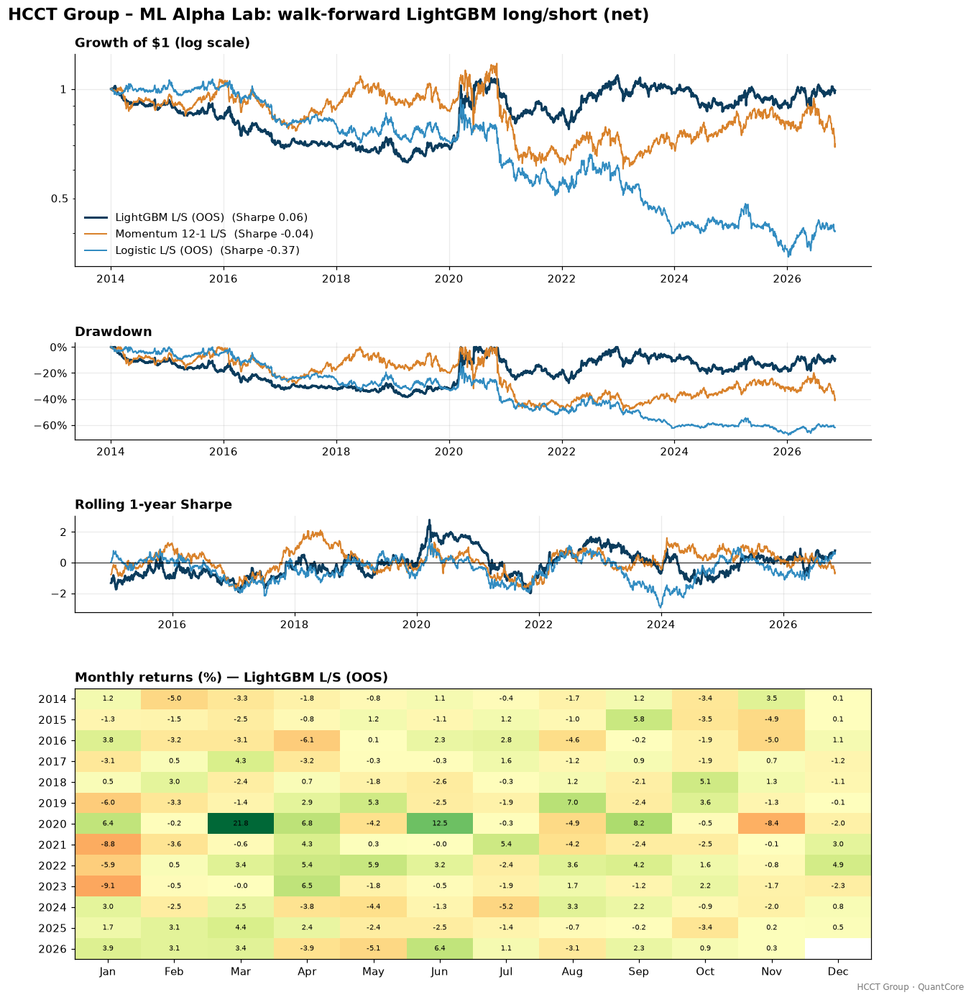

# ML Alpha Lab — full results

Generated by `python run_ml_alpha_lab.py`.

## Data and design

- Universe: 100 US large caps, Yahoo adjusted closes 2009-01-02 → 2026-11-06; SPY and ^VIX for market features.
- Events: 84,870 weekly (stock, Friday) events from 2010-07-23 with complete features and labels.
- Triple barrier: ±1.0 × σ_daily × √10, vertical barrier 10 days. Hits: profit-take 23.5%, stop-loss 19.4%, vertical 57.1%. Base rate of label 1 (positive return): 56.3%.
- Average uniqueness: mean 0.520, median 0.458 (min 0.333).
- FFD order d = 0.3 (smallest d with median ADF p < 0.05 on 2009–2013 data); window 388 bars at threshold 1e-4.
- Out-of-sample walk-forward period: 2014-01-02 → 2026-11-06, refit every January on purged expanding data.
- Runtime: 194 s.

## FFD order selection (training data only)

| d | median ADF p | share p<0.05 | corr with log price | window |
|---|---:|---:|---:|---:|
| 0.0 | 7.94e-01 | 0.000 | 1.000 | 1 |
| 0.1 | 5.67e-01 | 0.059 | 0.992 | 503 |
| 0.2 | 1.60e-01 | 0.353 | 0.956 | 497 |
| 0.3 | 6.67e-04 | 0.971 | 0.878 | 388 |
| 0.4 | 6.44e-09 | 1.000 | 0.763 | 282 |
| 0.5 | 7.01e-17 | 1.000 | 0.579 | 200 |
| 0.6 | 1.39e-24 | 1.000 | 0.411 | 140 |
| 0.7 | 2.08e-29 | 1.000 | 0.289 | 97 |
| 0.8 | 0.00e+00 | 1.000 | 0.175 | 64 |
| 0.9 | 0.00e+00 | 1.000 | 0.097 | 38 |
| 1.0 | 0.00e+00 | 1.000 | 0.042 | 2 |

## Feature stationarity (ADF, 2009–2013, sample of stocks)

| Feature | median ADF p | share stationary (p<0.05) | family |
|---|---:|---:|---:|
| log price (raw) | 0.796 | 0.000 | — |
| ret_5 | 4.36e-24 | 1.000 | Returns |
| ret_21 | 5.53e-08 | 1.000 | Returns |
| ret_63 | 9.34e-04 | 1.000 | Returns |
| ret_126 | 0.024 | 0.750 | Returns |
| mom_12_1 | 0.147 | 0.100 | Returns |
| vol_21 | 0.017 | 0.750 | Volatility |
| vol_63 | 0.079 | 0.450 | Volatility |
| vol_ratio | 2.93e-05 | 1.000 | Volatility |
| z_ma20 | 8.38e-16 | 1.000 | Mean reversion |
| z_ma100 | 2.77e-04 | 1.000 | Mean reversion |
| rsi_14 | 2.94e-10 | 1.000 | Mean reversion |
| ffd_logp | 3.31e-04 | 1.000 | Frac. diff. |
| xs_ret_21 | 6.85e-08 | 1.000 | Cross-sectional rank |
| xs_mom | 0.190 | 0.100 | Cross-sectional rank |
| xs_vol | 0.082 | 0.400 | Cross-sectional rank |
| spy_ret_21 | 3.10e-08 | 1.000 | Market regime |
| spy_trend | 0.018 | 1.000 | Market regime |
| vix | 0.008 | 1.000 | Market regime |
| vix_chg_21 | 4.55e-12 | 1.000 | Market regime |

## Cross-validation comparison (same models, same events)

| Model — scheme | Accuracy | AUC | Log loss | L/S Sharpe | N |
|---|---:|---:|---:|---:|---:|
| Momentum 12-1 — Shuffled K-fold | 0.502 | 0.504 | 1.017 | 0.066 | 84,870 |
| Momentum 12-1 — K-fold, no purge | 0.502 | 0.504 | 1.017 | 0.066 | 84,870 |
| Momentum 12-1 — Walk-forward | 0.501 | 0.503 | 1.020 | 0.047 | 67,900 |
| Momentum 12-1 — Purged K-fold + embargo | 0.502 | 0.504 | 1.017 | 0.066 | 84,870 |
| Logistic — Shuffled K-fold | 0.564 | 0.538 | 0.682 | 0.585 | 84,870 |
| Logistic — K-fold, no purge | 0.554 | 0.508 | 0.688 | 0.212 | 84,870 |
| Logistic — Walk-forward | 0.543 | 0.505 | 0.697 | -0.225 | 67,900 |
| Logistic — Purged K-fold + embargo | 0.555 | 0.508 | 0.688 | 0.296 | 84,870 |
| LightGBM — Shuffled K-fold | 0.658 | 0.717 | 0.626 | 1.237 | 84,870 |
| LightGBM — K-fold, no purge | 0.541 | 0.516 | 0.698 | 0.520 | 84,870 |
| LightGBM — Walk-forward | 0.536 | 0.522 | 0.711 | 0.084 | 67,900 |
| LightGBM — Purged K-fold + embargo | 0.543 | 0.522 | 0.696 | 0.444 | 84,870 |

Base rate (always predict 'up'): accuracy 0.563. L/S Sharpe = annualised Sharpe of the weekly top-minus-bottom quintile next-week return built from each scheme's OOS predictions (gross).

| Gap | AUC: shuffled − purged | Accuracy: shuffled − purged | L/S Sharpe: shuffled − purged |
|---|---:|---:|---:|
| Momentum 12-1 | 0.000 | 0.000 | 0.000 |
| Logistic | 0.030 | 0.009 | 0.290 |
| LightGBM | 0.195 | 0.115 | 0.793 |

Uniqueness-weight ablation (LightGBM, purged K-fold): with weights AUC 0.522, L/S Sharpe 0.44; unweighted AUC 0.519, L/S Sharpe 0.32.

## Combinatorial purged CV (N = 8, k = 2: 28 splits, 7 paths)

| Model | paths | mean | std | min | max | share > 0 |
|---|---:|---:|---:|---:|---:|---:|
| LightGBM | 7 | 0.38 | 0.16 | 0.16 | 0.61 | 100% |
| Logistic | 7 | 0.34 | 0.12 | 0.18 | 0.57 | 100% |

Momentum 12-1 rule over the same events (no fitting, single path): 0.07.

## Feature importance (LightGBM main config)

| Feature | MDI | MDA mean | MDA std | SHAP | Family |
|---|---:|---:|---:|---:|---:|
| spy_trend | 0.237 | 10.74 | 10.34 | 0.206 | Market regime |
| spy_ret_21 | 0.250 | 6.77 | 4.40 | 0.174 | Market regime |
| vix | 0.216 | 4.74 | 4.00 | 0.178 | Market regime |
| vix_chg_21 | 0.196 | 1.34 | 3.65 | 0.171 | Market regime |
| ffd_logp | 0.010 | 0.60 | 0.42 | 0.061 | Frac. diff. |
| ret_5 | 0.013 | 0.43 | 0.61 | 0.020 | Returns |
| xs_mom | 0.005 | 0.20 | 0.27 | 0.016 | Cross-sectional rank |
| ret_126 | 0.008 | 0.18 | 0.59 | 0.022 | Returns |
| xs_vol | 0.007 | 0.10 | 0.18 | 0.034 | Cross-sectional rank |
| xs_ret_21 | 0.002 | 0.07 | 0.19 | 0.010 | Cross-sectional rank |
| rsi_14 | 0.005 | 0.00 | 0.07 | 0.004 | Mean reversion |
| vol_63 | 0.010 | -0.02 | 0.28 | 0.009 | Volatility |
| vol_21 | 0.007 | -0.02 | 0.21 | 0.006 | Volatility |
| vol_ratio | 0.012 | -0.04 | 1.18 | 0.042 | Volatility |
| ret_21 | 0.002 | -0.08 | 0.16 | 0.006 | Returns |
| mom_12_1 | 0.006 | -0.13 | 0.26 | 0.011 | Returns |
| z_ma100 | 0.003 | -0.14 | 0.32 | 0.006 | Mean reversion |
| z_ma20 | 0.006 | -0.20 | 0.31 | 0.015 | Mean reversion |
| ret_63 | 0.004 | -0.32 | 0.54 | 0.007 | Returns |

MDA in units of 1e-3 log loss.

| Feature family (clustered MDA × 1e3) | mean | std |
|---|---:|---:|
| Market regime | 6.36 | 6.39 |
| Frac. diff. | 0.53 | 0.36 |
| Cross-sectional rank | 0.50 | 0.46 |
| Returns | 0.40 | 0.69 |
| Mean reversion | -0.23 | 0.40 |
| Volatility | -0.37 | 1.41 |

## Walk-forward backtests (2014-01-02 → 2026-11-06, net of 1 bp + 2 bp per trade and 50 bp/yr borrow)

| Metric | LightGBM L/S | Logistic L/S | Momentum 12-1 L/S | LightGBM long-only Q5 | Momentum long-only Q5 | EW universe | SPY |
|---|---:|---:|---:|---:|---:|---:|---:|
| CAGR | -0.07% | -6.80% | -2.68% | 15.87% | 16.19% | 14.96% | 13.32% |
| Ann. Vol | 14.03% | 15.68% | 19.67% | 15.45% | 19.22% | 16.27% | 17.12% |
| Sharpe | 0.06 | -0.37 | -0.04 | 1.03 | 0.88 | 0.94 | 0.82 |
| Max Drawdown | -38.47% | -67.62% | -48.79% | -26.01% | -33.10% | -35.52% | -33.72% |
| Calmar | -0.00 | -0.10 | -0.05 | 0.61 | 0.49 | 0.42 | 0.40 |
| Hit Rate | 50.25% | 49.35% | 52.69% | 55.36% | 56.10% | 55.42% | 55.04% |
| Avg Daily Turnover | 0.45 | 0.23 | 0.11 | 0.22 | 0.05 | 0.00 | 0.00 |
| Annual Cost Drag | 3.88% | 2.25% | 1.35% | 1.67% | 0.40% | 0.04% | 0.00% |
| Sharpe (gross) | 0.34 | -0.23 | 0.03 | 1.14 | 0.90 | 0.94 | 0.82 |
| Turnover (×/yr) | 112.65 | 58.15 | 28.34 | 55.69 | 13.49 | 1.20 | 0.08 |
| Beta | -0.29 | -0.44 | 0.03 | 0.76 | 0.99 | 0.89 | 1.00 |
| Alpha (ann.) | 4.93% | 0.30% | -1.12% | 5.40% | 3.15% | 2.83% | 0.08% |

## Model grid (walk-forward, L/S quintile, net) — the trials behind PBO and DSR

| Configuration | Sharpe (net) | Sharpe (gross) | CAGR | Max DD |
|---|---:|---:|---:|---:|
| LGBM leaves=31 trees=300 min_leaf=200 | 0.15 | 0.46 | 1.17% | -33.73% |
| LGBM leaves=15 trees=300 min_leaf=200 | 0.06 | 0.34 | -0.07% | -38.47% |
| LGBM leaves=15 trees=100 min_leaf=1000 | -0.01 | 0.25 | -1.28% | -34.47% |
| Momentum 12-1 rule | -0.04 | 0.03 | -2.68% | -48.79% |
| LGBM leaves=31 trees=300 min_leaf=1000 | -0.07 | 0.22 | -1.90% | -48.83% |
| LGBM leaves=15 trees=100 min_leaf=200 | -0.09 | 0.17 | -2.53% | -46.84% |
| LGBM leaves=15 trees=300 min_leaf=1000 | -0.11 | 0.17 | -2.45% | -46.13% |
| LGBM leaves=31 trees=100 min_leaf=1000 | -0.16 | 0.13 | -3.06% | -49.45% |
| LGBM leaves=7 trees=300 min_leaf=1000 | -0.17 | 0.06 | -3.55% | -50.57% |
| LGBM leaves=7 trees=300 min_leaf=200 | -0.17 | 0.06 | -3.59% | -41.21% |
| LGBM leaves=31 trees=100 min_leaf=200 | -0.23 | 0.05 | -4.23% | -49.67% |
| LGBM leaves=7 trees=100 min_leaf=1000 | -0.33 | -0.08 | -5.94% | -59.77% |
| Logit C=1 | -0.37 | -0.23 | -6.80% | -67.62% |
| Logit C=100 | -0.37 | -0.23 | -6.82% | -67.56% |
| Logit C=0.01 | -0.40 | -0.25 | -7.20% | -70.01% |
| LGBM leaves=7 trees=100 min_leaf=200 | -0.40 | -0.18 | -7.15% | -63.39% |

## Meta-labelling (out-of-sample events from 2014)

| Book | Precision | Recall | F1 | Trades taken |
|---|---:|---:|---:|---:|
| Primary only (momentum side) | 0.525 | 1.000 | 0.689 | 100.0% |
| Primary + meta (p > 0.5) | 0.561 | 0.634 | 0.595 | 59.3% |
| Primary + random filter (same rate) | 0.525 | 0.592 | 0.556 | 59.2% |

Meta-model OOS AUC for 'primary bet is profitable': 0.550.

| Metric | Primary: TS momentum | Primary + meta sizing | EW universe |
|---|---:|---:|---:|
| CAGR | 3.96% | 1.73% | 14.96% |
| Ann. Vol | 10.21% | 4.00% | 16.27% |
| Sharpe | 0.43 | 0.45 | 0.94 |
| Max Drawdown | -23.64% | -12.58% | -35.52% |
| Calmar | 0.17 | 0.14 | 0.42 |
| Hit Rate | 54.12% | 54.33% | 55.42% |
| Avg Daily Turnover | 0.03 | 0.02 | 0.00 |
| Annual Cost Drag | 0.36% | 0.14% | 0.04% |
| Sharpe (gross) | 0.47 | 0.49 | 0.94 |
| Turnover (×/yr) | 7.46 | 4.70 | 1.20 |
| Beta | 0.35 | 0.15 | 0.89 |

## Overfitting diagnostics

Trials counted: **21** (every configuration whose out-of-sample performance was computed, incl. the development check; benchmarks excluded). Cross-trial variance of daily Sharpe across the 16 L/S grid configs: 1.152e-04. Expected maximum Sharpe of 21 skill-less trials: 0.33 (annualised).

|  | LightGBM L/S (pre-specified) | Best L/S grid config (LGBM leaves=31 trees=300 min_leaf=200) | LightGBM long-only Q5 minus EW universe (active) | Momentum 12-1 L/S (single pre-registered rule, N = 1) |
|---|---:|---:|---:|---:|
| SR (ann.) | 0.065 | 0.154 | 0.095 | -0.039 |
| T | 3,232 | 3,232 | 3,232 | 3,232 |
| skew | 0.290 | 0.271 | -0.058 | -1.154 |
| kurtosis | 13.366 | 14.202 | 8.913 | 15.952 |
| N trials | 21 | 21 | 21 | 1 |
| SR0 (ann.) | 0.327 | 0.327 | 0.327 | 0.000 |
| PSR (vs 0) | 0.592 | 0.709 | 0.633 | 0.445 |
| DSR | 0.173 | 0.267 | 0.203 | 0.445 |

Minimum backtest length for the best L/S grid Sharpe (0.15) given 21 trials: **155.9 years** (we have 12.8). For the main LightGBM Sharpe (0.06): 878.9 years. For a target Sharpe of 0.5 / 1.0: 14.8 / 3.7 years.

PBO (CSCV, 16 grid configs, 16 blocks, 12,870 splits): **0.35**. Median OOS Sharpe of the IS winner: -0.11 vs median IS Sharpe 0.23. P(OOS Sharpe of IS winner < 0): 0.68.

Ex-post beta of LightGBM L/S to SPY: -0.29.

## Trial log

| # | stage | configuration | OOS Sharpe (ann.) | note |
|---|---:|---:|---:|---:|
| 1 | grid (walk-forward L/S quintile) | LGBM leaves=7 trees=100 min_leaf=200 | -0.398 |  |
| 2 | grid (walk-forward L/S quintile) | LGBM leaves=7 trees=100 min_leaf=1000 | -0.328 |  |
| 3 | grid (walk-forward L/S quintile) | LGBM leaves=7 trees=300 min_leaf=200 | -0.168 |  |
| 4 | grid (walk-forward L/S quintile) | LGBM leaves=7 trees=300 min_leaf=1000 | -0.167 |  |
| 5 | grid (walk-forward L/S quintile) | LGBM leaves=15 trees=100 min_leaf=200 | -0.087 |  |
| 6 | grid (walk-forward L/S quintile) | LGBM leaves=15 trees=100 min_leaf=1000 | -0.014 |  |
| 7 | grid (walk-forward L/S quintile) | LGBM leaves=15 trees=300 min_leaf=200 | 0.065 | pre-specified main model |
| 8 | grid (walk-forward L/S quintile) | LGBM leaves=15 trees=300 min_leaf=1000 | -0.111 |  |
| 9 | grid (walk-forward L/S quintile) | LGBM leaves=31 trees=100 min_leaf=200 | -0.230 |  |
| 10 | grid (walk-forward L/S quintile) | LGBM leaves=31 trees=100 min_leaf=1000 | -0.156 |  |
| 11 | grid (walk-forward L/S quintile) | LGBM leaves=31 trees=300 min_leaf=200 | 0.154 |  |
| 12 | grid (walk-forward L/S quintile) | LGBM leaves=31 trees=300 min_leaf=1000 | -0.066 |  |
| 13 | grid (walk-forward L/S quintile) | Logit C=0.01 | -0.395 |  |
| 14 | grid (walk-forward L/S quintile) | Logit C=1 | -0.370 |  |
| 15 | grid (walk-forward L/S quintile) | Logit C=100 | -0.373 |  |
| 16 | grid (walk-forward L/S quintile) | Momentum 12-1 rule | -0.039 |  |
| 17 | variant | LightGBM long-only top quintile | 1.031 |  |
| 18 | variant | Momentum long-only top quintile | 0.877 |  |
| 19 | benchmark | Equal-weight universe | 0.938 | benchmark, not a candidate |
| 20 | meta-labelling | Primary: time-series momentum side, equal weight | 0.432 |  |
| 21 | meta-labelling | Primary + LightGBM meta-label bet sizing | 0.450 |  |
| 22 | development | Pre-run check: LightGBM main config, 4 CV schemes (accuracy/AUC only) | — | looked at once while benchmarking speed; no setting changed afterwards |
